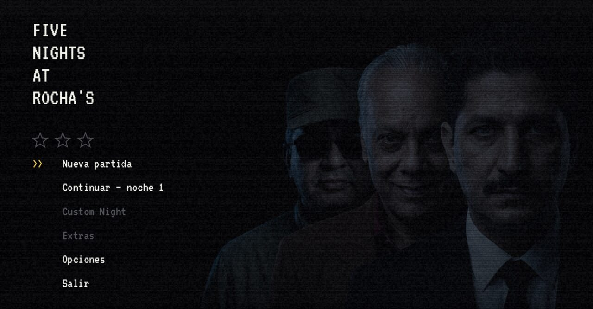
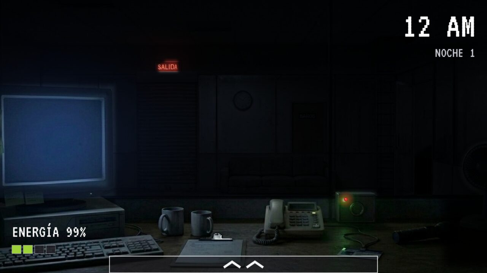
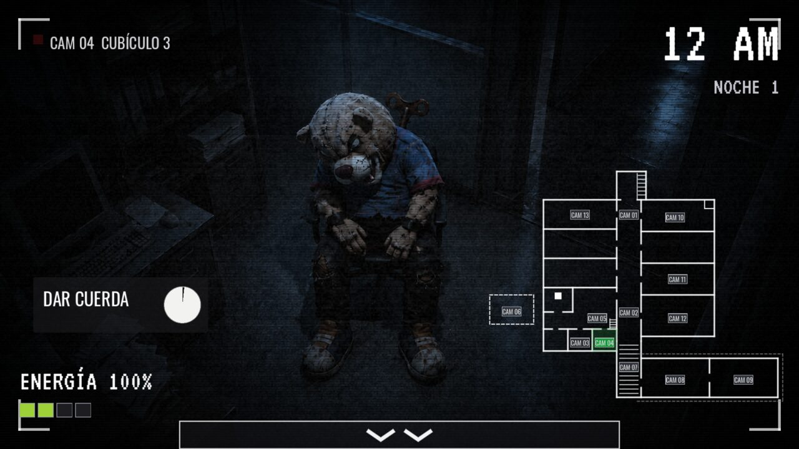
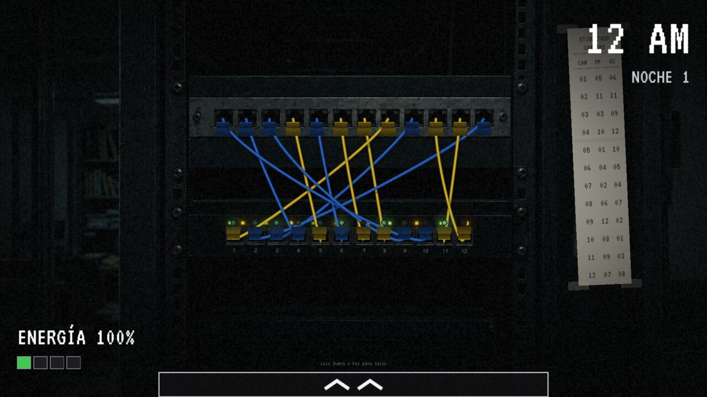
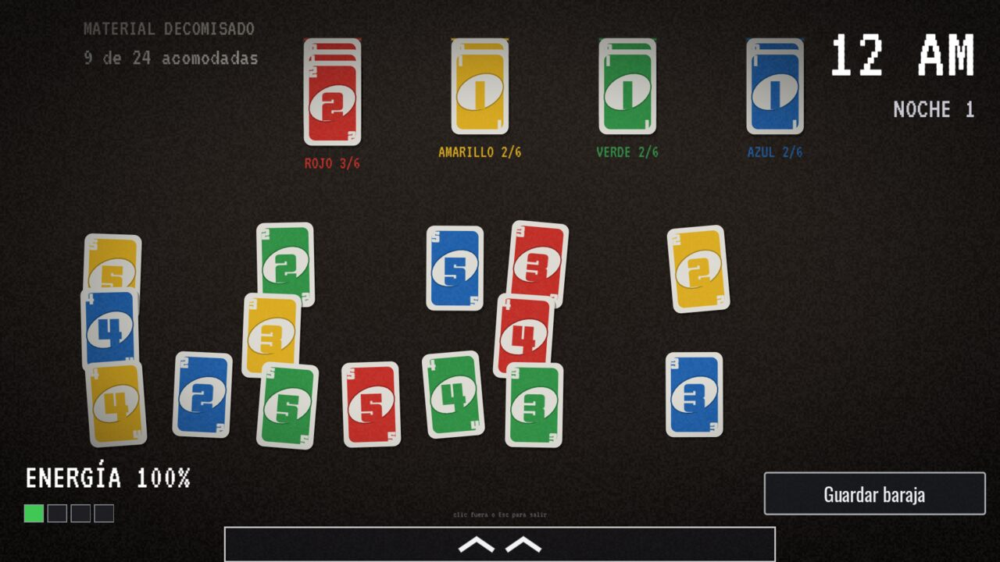
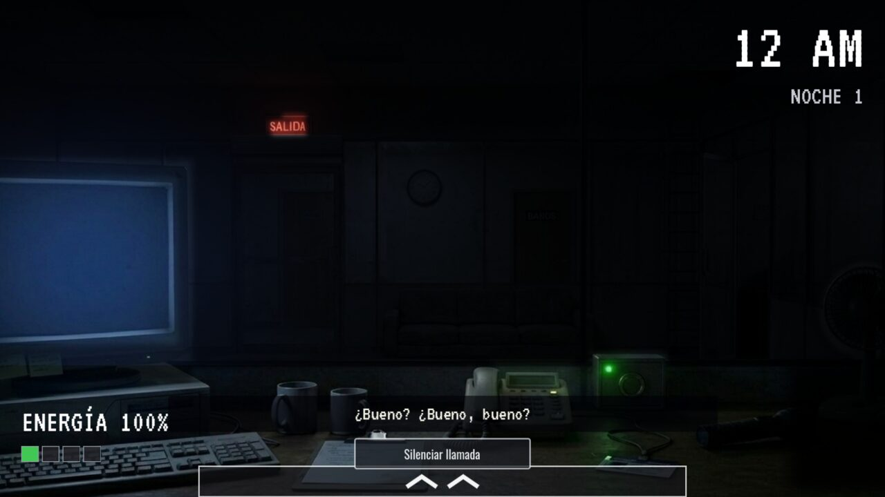
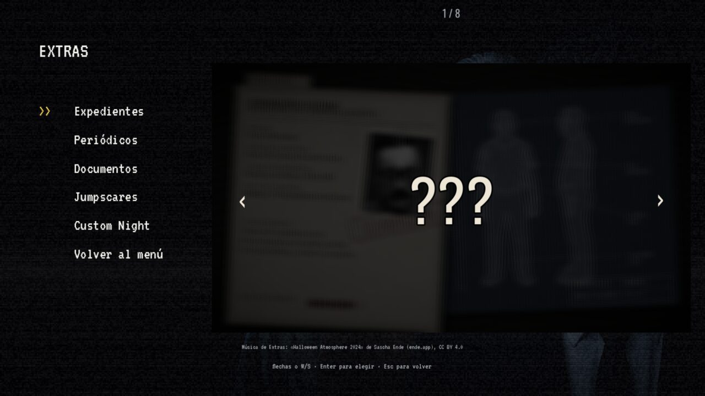
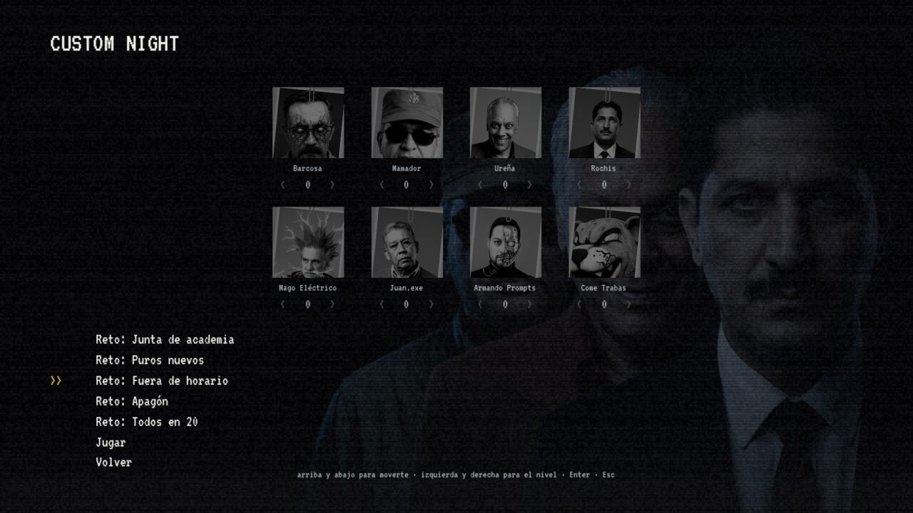
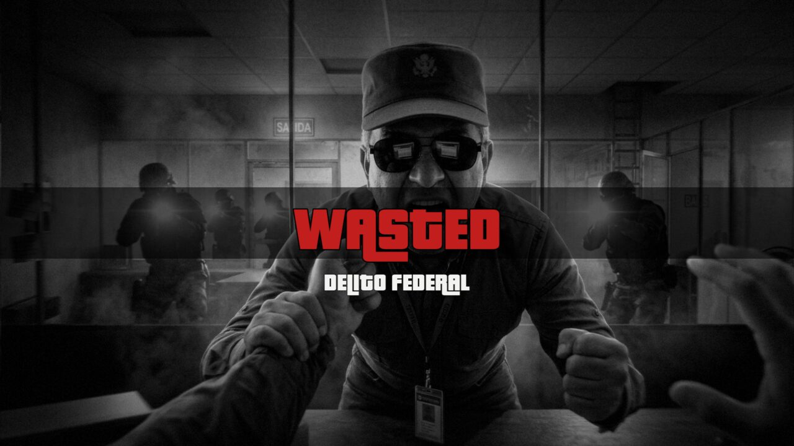

# Five Nights at Rocha's

Un juego de terror de supervivencia al estilo *Five Nights at Freddy's 2*, hecho en Godot, ambientado en un campus universitario. Eres el guardia nocturno de la Coordinación de Sistemas: de 12 AM a 6 AM tienes que vigilar las cámaras, cuidar la energía, hacer tu trabajo y que no te alcancen las almas de unos profesores que ya no se fueron a casa.

> **Estado: v0.9.2-beta.** Se juega de principio a fin, con las seis noches. Lo que todavía falta está en [Conocido](#conocido).

## Descargar

Baja el archivo de tu sistema desde la página de [**Releases**](https://github.com/MauriGGH/FNAR/releases), descomprime y abre el ejecutable. No hay nada que instalar.

| Sistema | Archivo | Tamaño |
| --- | --- | --- |
| Windows (64 bits) | `FiveNightsAtRochas_v0.9.2-beta_windows.zip` | 243 MB |
| Linux (64 bits) | `FiveNightsAtRochas_v0.9.2-beta_linux.zip` | 234 MB |

- **Windows:** el ejecutable no está firmado, así que SmartScreen puede avisar. Pulsa *Más información* y luego *Ejecutar de todas formas*.
- **Linux:** dale permiso de ejecución con `chmod +x FiveNightsAtRochas.x86_64`.
- Arranca en pantalla completa. **F11** alterna entre pantalla completa y ventana.
- Se juega con teclado y mouse. Con audífonos se disfruta mucho más: varias amenazas se oyen antes de verse.

## Cómo se juega

Sobrevive hasta las 6 AM. Cada hora de la noche dura unos 75 segundos, así que una noche completa son unos 7 minutos y medio. Son seis noches, y cada una aprieta un poco más.

### Controles

| Tecla | Qué hace |
| --- | --- |
| **A / D** o **← / →** | Cambiar de vista: izquierda, centro y derecha. El mouse solo mueve un poco la imagen |
| **Espacio** | Abrir y cerrar el monitor de cámaras |
| **Ctrl** (mantener) | Linterna hacia el pasillo. También sirve mantener el clic izquierdo sobre el cristal |
| **Clic** | Todo lo demás: la chapa de la puerta, la PC, el breaker, el teléfono, cambiar de cámara en el mapa |
| **Esc** | Pausa (desde ahí puedes ver los controles otra vez) |
| **F11** | Pantalla completa |
| **Supr** (mantener, en el menú) | Borrar el progreso |

La primera vez que juegas la noche 1 sale un recuadro con los controles y **el reloj no avanza** mientras lo tengas abierto. Después el juego casi no explica nada: lo que pasa se ve o se oye.

### Lo que tienes que cuidar

- **La energía.** Gastan la puerta cerrada, la linterna, las cámaras y la PC abierta, y además la instalación gasta un poco por sí sola, más cada noche. Si llega a 0 %, todo se apaga y no es un buen momento.
- **La puerta.** Se cierra con la chapa de la caja junto al teléfono. El foco de la chapa te dice cómo está: verde abierta, rojo latiendo cerrada. Cerrada gasta energía, y hay quien se fija en ella.
- **Las cámaras.** Trece, con un mapa del edificio. Un profe que entra o sale de la cámara que estás viendo la cubre de estática un instante.
- **La PC.** Es donde se hacen las tareas, y donde vive un asistente de IA muy educado que te ayuda con ellas. Úsala con cuidado.

### Las tareas

Para que te paguen hay que trabajar. A lo largo de la noche van llegando **tickets**: reiniciar un servicio, diagnosticar el laboratorio, configurar un equipo, reetiquetar cables. Se hacen en la PC (con una terminal y un simulador de redes), en la **sala de servidores** de la vista derecha, o en el propio escritorio.

Muchas tienen pasos que tardan, con barra de progreso, y **la barra solo avanza mientras la PC está abierta**. Ahí está el dilema de siempre: quedarte trabajando o quedarte vigilando. Al amanecer te dan tu recibo, con una nota a mano según cómo te fue.

| | |
| --- | --- |
|  |  |
| Reconectar los cables que se caen, según la hoja pegada al rack | Una tarea del escritorio. Cuidado con dejarla a la vista |

### Las llamadas

Al empezar la noche suena el teléfono. Si contestas, alguien te explica el puesto. No bloquea el juego: sigues usando cámaras y puerta, y puedes silenciarla cuando quieras. De vez en cuando también entra un número equivocado.

## Los profes

<b>Guía de cada uno y cómo quitártelo de encima</b> (spoilers de mecánicas, léelo si te atoras)

 

Ninguna amenaza se resuelve con la contramedida de otra.

| Quién | Cómo llega | Qué hacer |
| --- | --- | --- |
| **Barcosa** | Se esconde en el salón B (CAM 10). Si lo dejas sin mirar demasiado rato, sale corriendo hacia tu puerta | Échale un ojo a la CAM 10 cada cierto tiempo, **y míralo un momento**: una ojeada rápida no cuenta. Aun así, a veces sale por su cuenta. Si oyes pasos corriendo, **cierra la puerta** y espera a que se rinda. Con la puerta abierta, te atrapa |
| **Mamador** | Baja de la sala de juntas hasta el cristal y se queda unos segundos revisándolo todo | Ignora la linterna y las cámaras. Cuando llegue, **no tengas abierta la ventana de IA de la PC, no tengas la puerta cerrada y no tengas la baraja de UNO a la vista**. Si no encuentra nada, se va |
| **Ureña** | Sale de los baños, pasa por un salón y llega al cristal. Es lento | Cuando esté en el cristal, **apúntale con la linterna** hasta que se asuste y se vaya. Si no, entra |
| **Juan.exe** | Baja de la sala de juntas al cristal | Igual que Ureña: **linterna** en el cristal. No se ve sin ella |
| **Armando Prompts** | Misma ruta y misma linterna. Desde la noche 4, a veces se **apodera de la pantalla de la PC** | Linterna en el cristal. Si toma la PC, **escribe APÁGATE** antes de que se acabe el tiempo, o pierdes el progreso de tu tarea y parte de la energía |
| **Rochis** | Está sentado en la CAM 3 y se va levantando poco a poco | Mientras se levanta, usa el botón de la cámara para **hacer que se vuelva a sentar**. Si llega a estar de pie, entra a la oficina |
| **Mago Eléctrico** | Vive en el techo (CAM 6) y baja por la escalera (CAM 5). Desde ahí también puede tirar tus cables | Si lo ves en la escalera, **baja el breaker** (vista izquierda) y regresa al techo. Si entra, te deja sin linterna un buen rato y se lleva un pedazo de energía. No mata, pero **la energía en 0 % sí** |
| **Come Trabas** | Una botarga sentada en la CAM 4, con una llave de cuerda en la espalda | **Dale cuerda** manteniendo el botón en la CAM 4 antes de que se le acabe. Si lo dejas sin cuerda, se levanta y va por ti |

**Consejos que no estaban en ningún manual:**

- Cada cámara que miras gasta. Revisa lo justo.
- La linterna no se apunta: ilumina todo el pasillo de golpe. Mantenerla sirve igual que dar parpadeos, lo que cuenta es la luz acumulada.
- Los sonidos importan. Pasos corriendo, un llavero, una cajita de música a lo lejos: cada cosa avisa de algo.
- No todo lo que ves en pantalla es real. A veces algo aparece un instante y se va, y no hace nada. Casi siempre.
- Si te van a atrapar, a veces alguien baja a salvarte. Y a veces es porque te lo ganaste.

## La historia

La historia no se cuenta en ninguna cinemática: **se descubre**. Al terminar cada noche te llega un recorte de periódico, y entre uno y otro se arma lo que pasó en este campus. Hay un termo, una fiesta, un alumno que desapareció y una junta que nadie recuerda haber convocado.

Todo apunta a un responsable que sigue sin aparecer.

Los expedientes de cada profe, los recortes, los recibos y las cartas que vayas encontrando se guardan en **Extras**, donde puedes releerlos con calma.

## Más cosas

- **Extras** *(se abre al pasar la noche 5)*: expedientes de los ocho profes, los periódicos, tus documentos, una galería de sustos y la Custom Night.
- **Custom Night:** elige el nivel de cada profe de 0 a 20 y aguanta. Incluye retos con los niveles ya puestos, como *Junta de academia*, *Fuera de horario* o *Apagón*.
- **Tres estrellas** en el menú principal: una al pasar la noche 5, otra al pasar la 6 y otra al ganar una Custom Night con los ocho profes en 20.
- **La maquinita:** de vez en cuando, entre una noche y otra, se enciende una maquinita de 8 bits. Lo que cuenta pasó de verdad, y pasarla puede servirte más adelante.
- **Se guarda solo.** Tu progreso queda en tu carpeta de usuario.

Y si dejas la puerta cerrada cuando no debías:

## Conocido

Es una beta. Lo poco que falta es sonido:

- **Quedan unos pocos sonidos provisionales**, hechos por código mientras se graban los de verdad: el agua de los baños, el módem de Armando, los pitidos de los menús, el tono de ocupado del teléfono y las cartas de la baraja. La música de la maquinita es chiptune hecho por código, y así se queda.

Si encuentras un fallo o algo que no cuadra, abre un [issue](https://github.com/MauriGGH/FNAR/issues) y cuéntanos qué noche era y qué estabas haciendo. El historial de versiones está en [CHANGELOG.md](CHANGELOG.md).

## Para quien quiera abrir el proyecto

- **Motor:** Godot **4.7.2**, renderizador Compatibilidad, GDScript con tipado estático. Abre `project.godot` desde el gestor de proyectos.
- **Panel de pruebas:** dentro del editor, con `NightConfig.DEBUG_KEYS = true`, **F1** abre un panel para forzar sucesos y capturar todas las pantallas. **No existe en el juego exportado**, aunque la constante esté activa.
- **Exportar:** los presets de Windows y Linux ya están en `export_presets.cfg`. Hacen falta las plantillas de exportación de Godot 4.7.2.
- **Lo que falta por grabar:** [docs/audios_faltantes.md](docs/audios_faltantes.md) y [docs/pendientes.md](docs/pendientes.md).

## Créditos

- **Creado y desarrollado por [MauriGGH](https://github.com/MauriGGH).**
- Hecho con [Godot Engine](https://godotengine.org/).
- **Música de Extras y de la Custom Night:** *«Halloween Atmosphere 2024»* de **Sascha Ende** ([ende.app](https://ende.app)), bajo licencia [CC BY 4.0](https://creativecommons.org/licenses/by/4.0/).
- **Tipografías:** VT323, Oswald, Share Tech Mono, DSEG14 y Reenie Beanie (SIL Open Font License) y Special Elite (Apache 2.0). Sus licencias están junto a los archivos, en `assets/fonts/`.
- Inspirado en la saga *Five Nights at Freddy's* de Scott Cawthon. Este proyecto no tiene relación con ella.
